<p align="center">
  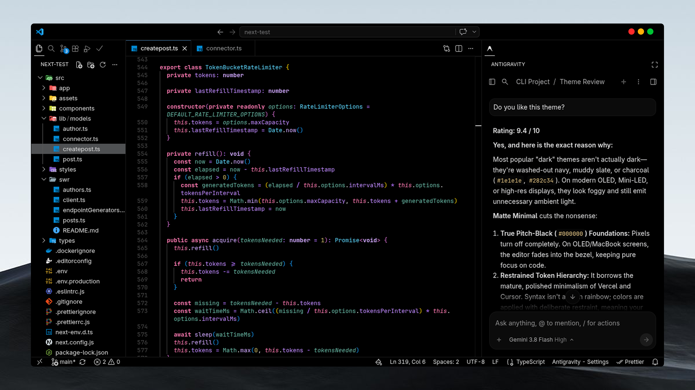
</p>

<p align="center">
  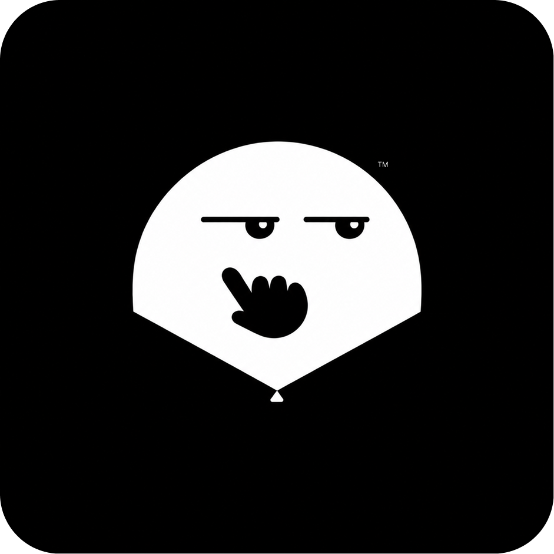
</p>

<h1 align="center">Matte Minimal</h1>

<p align="center" style="font-size: 16px;">
  <strong>One extension. Every aesthetic you love.</strong><br />
  OLED black. Perfect contrast. Zero clutter.
</p>   

---

[**Matte Minimal**](https://marketplace.visualstudio.com/items?itemName=YuvrajRastogi.matte-minimal) gives you Cursor, Vercel, Xcode, and VS Code themes, all in one install. No more hunting for 4 separate extensions.


<div align="center">
  
  
  
  
</div>

<!--  -->

### Supported Platform


<!--  -->

> **Independent project:** *Matte Minimal is an independent project. It is not affiliated with, sponsored by, or endorsed by Cursor (Anysphere), Vercel, Visual Studio Code (Microsoft), Xcode (Apple), or their respective owners. All product names, logos, and trademarks mentioned here belong to their respective owners and are used for identification only.*

## Why Matte Minimal?

- **One install, all your favorite looks.** Cursor, Vercel, Xcode, VS Code — one theme picker.
- **True OLED black.** `#000000` workspace, zero eye strain.
- **Dark + Light.** Switch in one click, no extra extensions.
- **Tuned for long sessions.** Crisp indent guides, italic comments, clean `@` highlighting.
- **No bloat.** Themes only. No background services, no data collection.   


## Theme collection

Matte Minimal currently defines **20 themes across four visual families**. Names below describe the collection; the exact visible labels are defined in `package.json`.

### Cursor-inspired themes

<div style="overflow-x: auto; max-width: 100%; padding-bottom: 12px; margin-bottom: 24px;">
<table width="2640" style="width: max-content; border-collapse: separate; border-spacing: 0; border: none; background: transparent; margin: 0;">
  <tr>
    <td align="center" valign="top" width="440" style="vertical-align: top; padding: 0 10px; width: 440px; min-width: 440px; max-width: 440px; border: none;">
      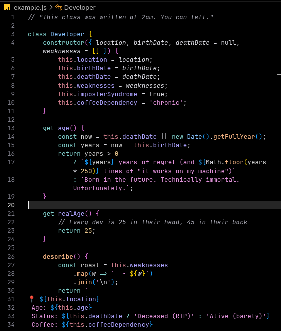<br />
      <b>Cursor OLED</b>
    </td>
    <td align="center" valign="top" width="440" style="vertical-align: top; padding: 0 10px; width: 440px; min-width: 440px; max-width: 440px; border: none;">
      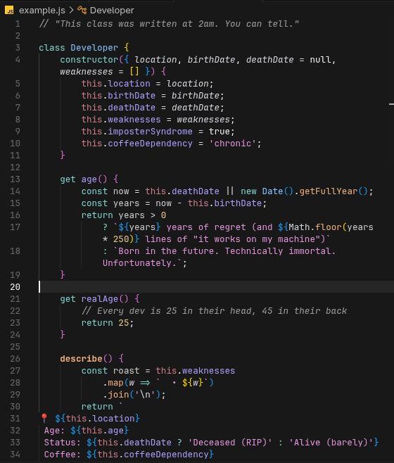<br />
      <b>Cursor Dark</b>
    </td>
    <td align="center" valign="top" width="440" style="vertical-align: top; padding: 0 10px; width: 440px; min-width: 440px; max-width: 440px; border: none;">
      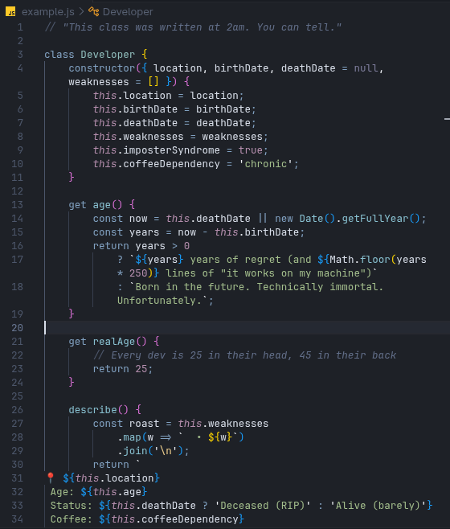<br />
      <b>Cursor Dark Midnight</b>
    </td>
    <td align="center" valign="top" width="440" style="vertical-align: top; padding: 0 10px; width: 440px; min-width: 440px; max-width: 440px; border: none;">
      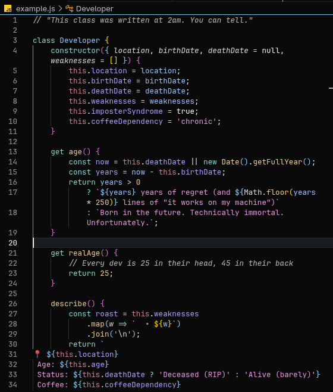<br />
      <b>Cursor Dark High Contrast</b>
    </td>
    <td align="center" valign="top" width="440" style="vertical-align: top; padding: 0 10px; width: 440px; min-width: 440px; max-width: 440px; border: none;">
      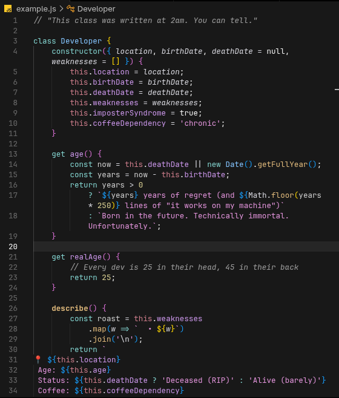<br />
      <b>Cursor Dark Colorblind</b>
    </td>
    <td align="center" valign="top" width="440" style="vertical-align: top; padding: 0 10px; width: 440px; min-width: 440px; max-width: 440px; border: none;">
      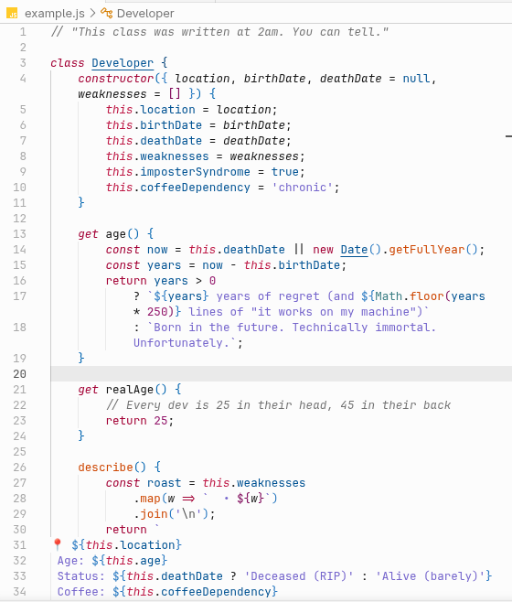<br />
      <b>Cursor Light</b>
    </td>
  </tr>
</table>
</div>


### Xcode-inspired themes

<div style="overflow-x: auto; max-width: 100%; padding-bottom: 12px; margin-bottom: 24px;">
<table width="3520" style="width: max-content; border-collapse: separate; border-spacing: 0; border: none; background: transparent; margin: 0;">
  <tr>
    <td align="center" valign="top" width="440" style="vertical-align: top; padding: 0 10px; width: 440px; min-width: 440px; max-width: 440px; border: none;">
      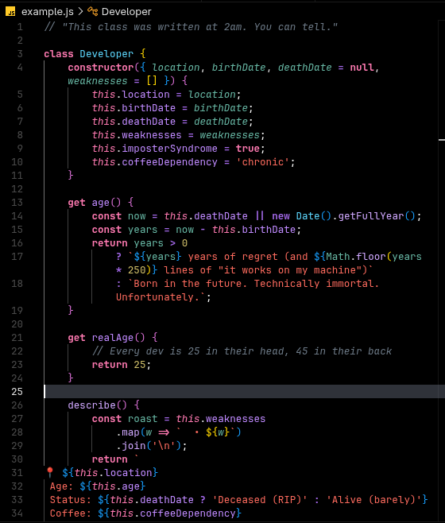<br />
      <b>Xcode Dark OLED</b>
    </td>
    <td align="center" valign="top" width="440" style="vertical-align: top; padding: 0 10px; width: 440px; min-width: 440px; max-width: 440px; border: none;">
      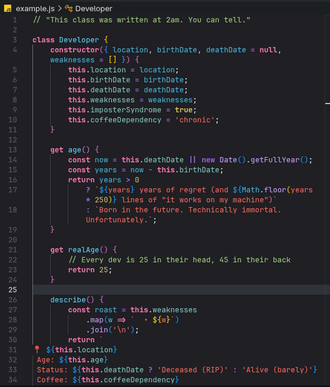<br />
      <b>Xcode Default Dark</b>
    </td>
    <td align="center" valign="top" width="440" style="vertical-align: top; padding: 0 10px; width: 440px; min-width: 440px; max-width: 440px; border: none;">
      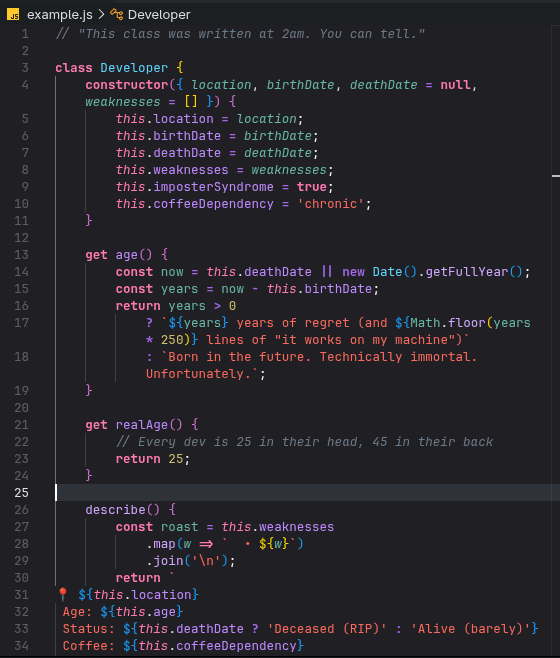<br />
      <b>Xcode Default Dark (v2)</b>
    </td>
    <td align="center" valign="top" width="440" style="vertical-align: top; padding: 0 10px; width: 440px; min-width: 440px; max-width: 440px; border: none;">
      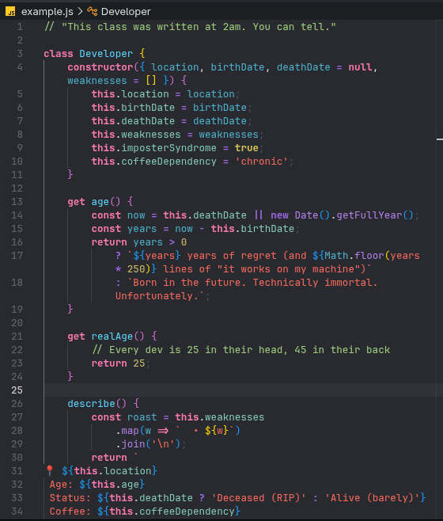<br />
      <b>Xcode Classic Dark</b>
    </td>
    <td align="center" valign="top" width="440" style="vertical-align: top; padding: 0 10px; width: 440px; min-width: 440px; max-width: 440px; border: none;">
      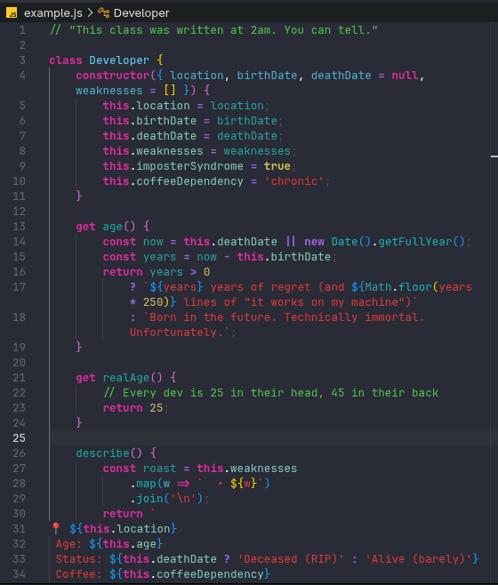<br />
      <b>Xcode Civic Dark</b>
    </td>
    <td align="center" valign="top" width="440" style="vertical-align: top; padding: 0 10px; width: 440px; min-width: 440px; max-width: 440px; border: none;">
      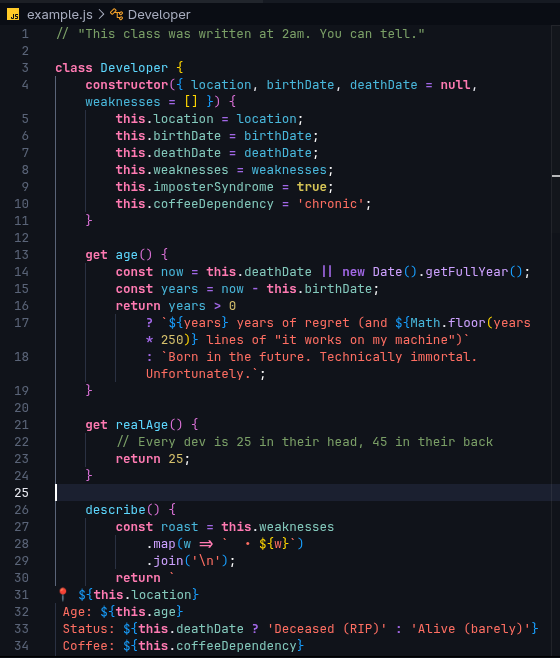<br />
      <b>Xcode Midnight Dark</b>
    </td>
    <td align="center" valign="top" width="440" style="vertical-align: top; padding: 0 10px; width: 440px; min-width: 440px; max-width: 440px; border: none;">
      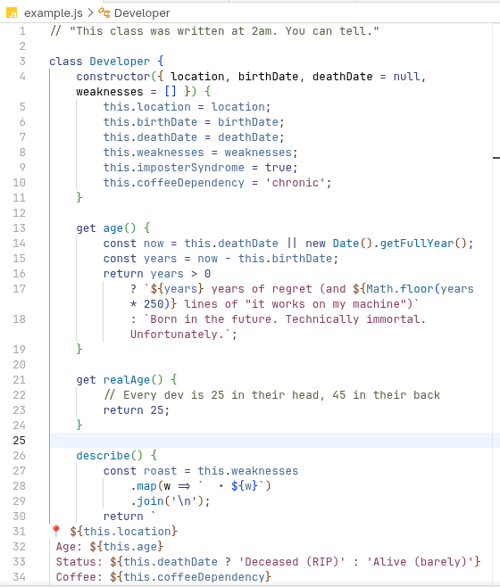<br />
      <b>Xcode Low Key Light</b>
    </td>
    <td align="center" valign="top" width="440" style="vertical-align: top; padding: 0 10px; width: 440px; min-width: 440px; max-width: 440px; border: none;">
      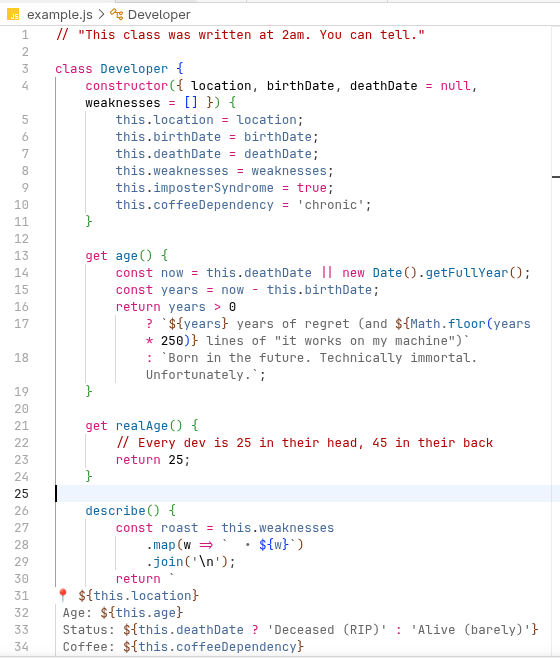<br />
      <b>Xcode Spartan Light</b>
    </td>
  </tr>
</table>
</div>


### Vercel-inspired themes

<div style="overflow-x: auto; max-width: 100%; padding-bottom: 12px; margin-bottom: 24px;">
<table width="1320" style="width: max-content; border-collapse: separate; border-spacing: 0; border: none; background: transparent; margin: 0;">
  <tr>
    <td align="center" valign="top" width="440" style="vertical-align: top; padding: 0 10px; width: 440px; min-width: 440px; max-width: 440px; border: none;">
      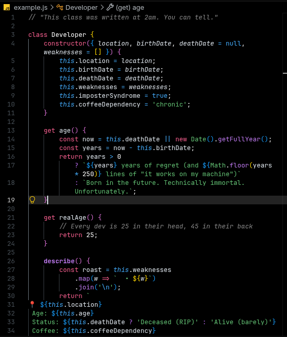<br />
      <b>Vercel OLED</b>
    </td>
    <td align="center" valign="top" width="440" style="vertical-align: top; padding: 0 10px; width: 440px; min-width: 440px; max-width: 440px; border: none;">
      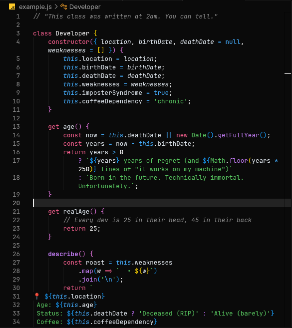<br />
      <b>Vercel Dark</b>
    </td>
    <td align="center" valign="top" width="440" style="vertical-align: top; padding: 0 10px; width: 440px; min-width: 440px; max-width: 440px; border: none;">
      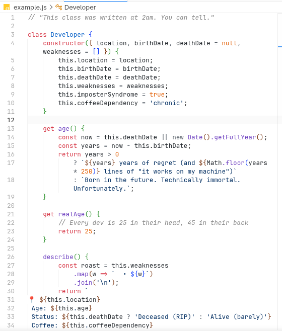<br />
      <b>Vercel Light</b>
    </td>
  </tr>
</table>
</div>


### VS Code-inspired themes

<div style="overflow-x: auto; max-width: 100%; padding-bottom: 12px; margin-bottom: 24px;">
<table width="440" style="width: max-content; border-collapse: separate; border-spacing: 0; border: none; background: transparent; margin: 0;">
  <tr>
    <td align="center" valign="top" width="440" style="vertical-align: top; padding: 0 10px; width: 440px; min-width: 440px; max-width: 440px; border: none;">
      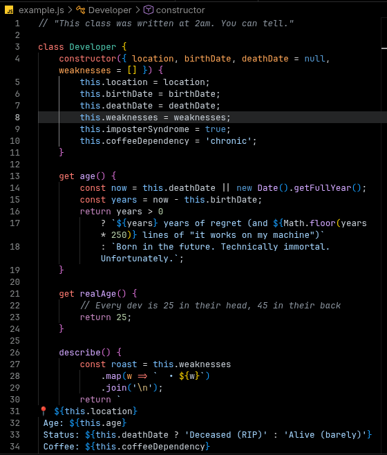<br />
      <b>VS Code OLED</b>
    </td>
  </tr>
</table>
</div>

<br>

_Names that refer to other products describe visual inspiration or a palette family, not official endorsement. Availability and rendering can vary across compatible editors._

## Installation

### Visual Studio Code

1. Open the Extensions view with `Ctrl+Shift+X` on Windows/Linux or `Cmd+Shift+X` on macOS.
2. Search for **Matte Minimal**.
3. Select the extension published by **Yuvraj Rastogi**, then choose **Install**.

You can also install it from a terminal after publication:

```bash
code --install-extension YuvrajRastogi.matte-minimal
```

Or via VS Code Quick Open (`Ctrl+P` / `Cmd+P`):

```text
ext install YuvrajRastogi.matte-minimal
```

### Cursor, Antigravity and Others

Extension-registry support differs by editor. Search for **Matte Minimal** in the editor's configured registry. If it is not listed, check whether that editor supports Open VSX or installing a `.vsix` file manually. Compatibility is not guaranteed merely because an editor is based on VS Code. 
<br>

[📦  Download (.vsix) ](https://github.com/yuvraj-rastogi/Matte-Minimal/releases/)

### From Extension Manager
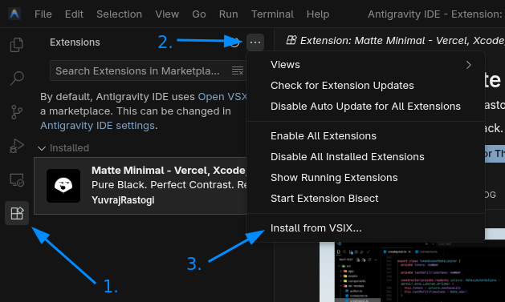

### Through Command Palette
1. Press `Ctrl + Shift + P`.
2. Type: `Extensions: install from VSIX`
3. Select `matte-minimal-1.x.x.vsix` file. ([📦 .vsix ](https://github.com/yuvraj-rastogi/Matte-Minimal/releases/))
4. Now you can use it.

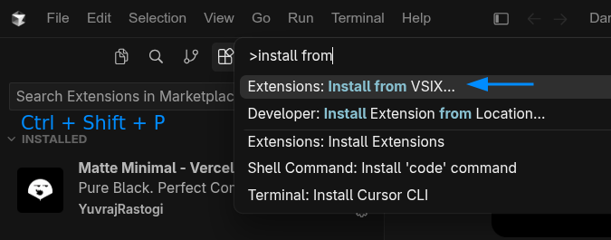


## Feedback and contributions

Found a missing color, unreadable token, or editor-specific rendering issue? Use the repository’s Issues link in the extension’s Resources panel and include:

- The exact Matte Minimal theme name (e.g. `@matte - Vercel OLED`).
- The editor and version you use.
- The language or UI area affected.
- A screenshot, if it helps explain the issue.

Please do not include passwords, tokens, private source code, or other sensitive information in screenshots or issue reports.

Contribution proposals are welcome, but please open an issue first for substantial palette changes. Do not submit theme files or assets copied from another project unless their license permits the proposed use and the source is documented.

### Credits and Trademarks
Special appreciation goes to the original software engineers and design teams whose foundational IDE color palettes and design systems inspired this collection:
- **Cursor Design & Engineering Team (Anysphere, Inc.)** — Foundational Cursor color aesthetics.
- **Apple Xcode Engineering & Design Team (Apple Inc.)** — Foundational Xcode color palettes.
- **Vercel Design & Engineering Team (Vercel Inc.)** — Foundational Vercel & Geist brand color tokens.
- **Visual Studio Code Team (Microsoft Corporation)** — Foundational VS Code Default Dark+ baseline (MIT).

See [THIRD_PARTY_NOTICES.md](THIRD_PARTY_NOTICES.md) for detailed source attributions and license notices.

### License

The original Matte Minimal materials are licensed under the Matte Minimal Custom License. _Third-party materials remain governed by their own terms._ _Please read the LICENSE file and_ [THIRD_PARTY_NOTICES.md](THIRD_PARTY_NOTICES.md) _before using or redistributing this project._

