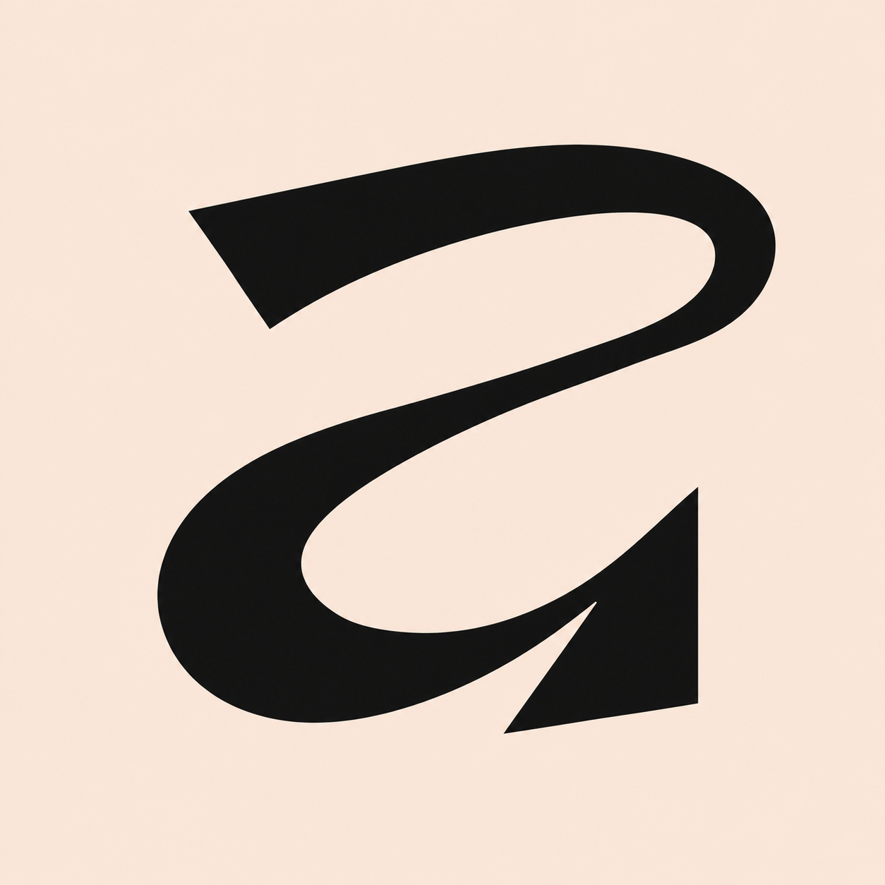

<p align="center">
  
</p>

<h1 align="center">SUMIRO</h1>

<p align="center">
  <strong>One extension. Multiple editor aesthetics.</strong><br />
  A curated collection of OLED-black, dark, and light color themes for Visual Studio Code and compatible editors.
</p>

<p align="center">
  <em>Independent theme collection by Yuvraj Rastogi</em>
</p>

<!-- After the extension is published, you can add official Marketplace badges here. Avoid hard-coded download counts or version numbers. -->

SUMIRO brings several visual styles together in one extension, so you can switch between them without installing a separate theme extension for every look. Choose a deep dark workspace, a true-black OLED variant, or a clean light palette from the same theme picker.

> **Independent project:** SUMIRO is not affiliated with, sponsored by, or endorsed by Cursor, Vercel, Microsoft, Apple, or their respective products. Their names are used only to identify the design inspirations or theme variants. See [Third-party notices](THIRD_PARTY_NOTICES.md).

## Why SUMIRO?

- **One install, many styles.** Keep the theme families you like in one extension.
- **OLED-focused options.** Selected variants use a pitch-black `#000000` workspace background, with complementary UI colors chosen for separation and readability.
- **Dark and light choices.** Switch visual styles without managing several separate theme extensions.
- **A consistent theme picker.** Find variants by searching for terms such as `OLED`, `Cursor`, `Vercel`, `VS Code`, or `Xcode`.
- **Theme-only.** SUMIRO provides color themes; it does not need to run a background service or collect your project data.

Color appearance and contrast depend on the selected theme, editor, display, and user settings. OLED-black backgrounds do not guarantee lower eye strain or accessibility for every user.

## Theme collection

SUMIRO currently defines **20 themes across four visual families**. Names below describe the collection; the exact visible labels are defined in `package.json`.

### Cursor-inspired themes

| Theme | Style |
| --- | --- |
| Cursor OLED | Pitch-black OLED variant |
| Cursor Dark | Classic dark palette |
| Cursor Dark Midnight | Deeper midnight dark palette |
| Cursor Dark High Contrast | High-contrast dark variant |
| Cursor Dark Colorblind | Alternate dark color variant |
| Cursor Light | Light palette |
| Cursor Light High Contrast | High-contrast light variant |
| Cursor Light Colorblind | Alternate light color variant |

### Vercel-inspired themes

| Theme | Style |
| --- | --- |
| Vercel Dark | Minimal dark palette with OLED-oriented black surfaces |
| Vercel Light | Minimal light palette |

### VS Code-inspired themes

| Theme | Style |
| --- | --- |
| VS Code OLED | VS Code-inspired palette adapted for a pitch-black workspace |

### Xcode-inspired themes

| Theme | Style |
| --- | --- |
| Xcode Classic Dark | Classic dark palette |
| Xcode Dark OLED | Dark palette adapted for pitch-black surfaces |
| Xcode Classic Light | Classic light palette |
| Xcode Default Dark | Default-style dark palette |
| Xcode Default Dark (Modified) | Modified dark variant |
| Xcode Civic Dark | Civic dark palette |
| Xcode Midnight Dark | Midnight dark palette |
| Xcode Low Key Light | Low-key light palette |
| Xcode Spartan Light | Minimal light palette |

Names that refer to other products describe visual inspiration or a palette family, not official endorsement. Availability and rendering can vary across compatible editors.

<!--
PRE-PUBLISH SCREENSHOT GALLERY
Capture real screenshots, save them in assets/screenshots/, and then uncomment this section.

## Preview

<p align="center">
  
</p>
<p align="center">
  
</p>
<p align="center">
  
</p>
<p align="center">
  
</p>
-->

## Installation

### Visual Studio Code

After SUMIRO is published to the Visual Studio Marketplace, install it from the Extensions view:

1. Open the Extensions view with `Ctrl+Shift+X` on Windows/Linux or `Cmd+Shift+X` on macOS.
2. Search for **SUMIRO**.
3. Select the extension published by `yuvraj-rastogi`, then choose **Install**.

You can also install it from a terminal after publication:

```bash
code --install-extension yuvraj-rastogi.sumiro
```

### Cursor and other VS Code-compatible editors

Extension-registry support differs by editor. Search for SUMIRO in the editor's configured registry. If it is not listed, check whether that editor supports Open VSX or installing a `.vsix` file manually. Compatibility is not guaranteed merely because an editor is based on VS Code.

## Apply a theme

1. Open the theme picker with `Ctrl+K Ctrl+T` on Windows/Linux or `Cmd+K Cmd+T` on macOS.
2. Search for `OLED`, `Cursor`, `Vercel`, `VS Code`, or `Xcode`.
3. Preview a theme, then press `Enter` to apply it.

You can return to the same picker at any time to switch themes. Theme labels may be updated between releases; use the names displayed by your installed version.

## Compatibility

SUMIRO uses the standard VS Code color-theme contribution format. It is intended for Visual Studio Code and compatible editors that support these theme contributions. Individual editors may render UI colors differently or omit some theme color keys. Test your preferred theme in your own editor and version.

This project does not claim compatibility with every VS Code-derived editor or every web/remote environment.

## Feedback and contributions

Found a missing color, unreadable token, or editor-specific rendering issue? Use the repository’s Issues link in the extension’s Resources panel and include:

- The exact SUMIRO theme name.
- The editor and version you use.
- The language or UI area affected.
- A screenshot, if it helps explain the issue.

Please do not include passwords, tokens, private source code, or other sensitive information in screenshots or issue reports.

Contribution proposals are welcome, but please open an issue first for substantial palette changes. Do not submit theme files or assets copied from another project unless their license permits the proposed use and the source is documented.

## Credits and trademarks

SUMIRO is an independent project. Some palettes and visual choices are inspired by familiar editor and product aesthetics, including Cursor, Vercel, Visual Studio Code, and Xcode. The names and marks of those products belong to their respective owners. No affiliation, sponsorship, or endorsement is claimed.

Attribution is not a substitute for permission to redistribute third-party material. Where an upstream file, palette, or asset is included or adapted, its source, applicable terms, and any required notices must be recorded in [THIRD_PARTY_NOTICES.md](THIRD_PARTY_NOTICES.md). Do not distribute material unless you have verified the relevant rights.

## License

The original SUMIRO materials are distributed under the [SUMIRO Custom Use and Redistribution License](LICENSE). This is a custom, restrictive license; it is **not an OSI-approved open-source license**. Any third-party materials remain subject to their own applicable terms. Read the license and third-party notices before using or redistributing the project.

The SUMIRO logo is original artwork created by Yuvraj Rastogi and is protected by copyright. It is provided for display as part of the genuine SUMIRO extension and official project listings only. Reuse, modification, redistribution, resale, and commercial use of the logo require prior written permission.

See the `LICENSE` file for the full terms.